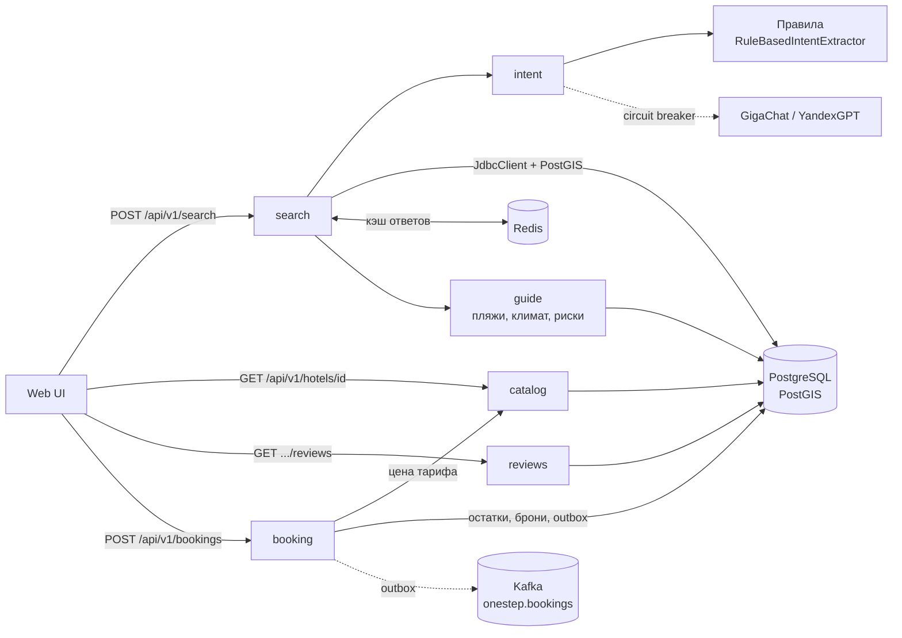

# О!дин шаг — отель одним запросом

> Хакатон Островка 2026, трек «О!дин шаг до идеального отеля». Команда **ChevTeam**.

Пользователь пишет поездку своими словами, система понимает запрос, подбирает отели, считает цену **всей поездки** и **объясняет** каждый выбор.

```
«Хочу в Турцию на 10 дней в мае, всё включено, отель с аквапарком,
  двое взрослых и ребёнок 7 лет, до 80 тысяч. Лечу из Москвы, лучше прямой»
                                   │
                                   ▼
Ищем: Турция · май 2027 · 9 ночей · 2 взр. + ребёнок 7 лет · до 80 000 ₽ · Всё включено · Аквапарк
                                   │
99%  Aqua Riviera Resort & Spa                                       66 600 ₽
     ✓ В бюджете — остаётся 13 400 ₽   ✓ Всё включено   ✓ Аквапарк
     ✓ Семьи с детьми ставят 9.4       ✓ Отличный рейтинг 9.1
     i Трансфер из аэропорта ≈35 мин   i Бесплатная отмена
```

## Что внутри

| Возможность | Как сделано |
|---|---|
| Понимание запроса на русском | Детерминированный парсер (падежи, числительные, «двое суток», «10 дней = 9 ночей», «выходные в январе») + **GigaChat / YandexGPT** |
| AI с ограждениями | Факты, явно найденные в тексте, LLM переопределить не может; LLM заполняет только догадки. Невалидные значения отбрасываются по полям |
| Отказоустойчивость | Circuit breaker (Resilience4j): LLM упал → ответ по правилам, а не 500. Redis упал → поиск без кэша |
| Гео-поиск | PostGIS: «до Эрмитажа пешком 15 минут» → радиус с учётом извилистости улиц, GiST-индекс |
| Объяснимый ранжир | Каждое пожелание имеет вес; карточка показывает ✓ / ~ / ✕ причины и % совпадения |
| Цена поездки | Тариф × сезонный коэффициент × ночи, деньги — только `BigDecimal` |
| Прозрачность | Ответ содержит «как мы поняли», допущения («считаем 2 взрослых») и уточняющие вопросы |
| Бронирование | Удержание номера на 15 минут → тестовая оплата → подтверждение. Без овербукинга даже при гонке за последний номер |
| Деньги без дублей | `Idempotency-Key` на каждом изменяющем запросе: повтор или двойной клик не создают вторую бронь и не списывают дважды |
| События | Transactional outbox (Spring Modulith) → Kafka: событие брони не теряется, даже если брокер лежит |
| Паспорт пляжа | Песок или галька (и какие), вход в воду, резкий обрыв глубины, приливы и отливы, протяжённость и загруженность, активности по сезонам, развлечения, «детям / пожилым / на коляске» |
| Сезон и риски | Погода в месяц поездки (воздух, вода, дожди, волны, «изнуряющая жара») и сезонные риски: медузы, комары, клещи, тягун, тайфуны, цветение воды |
| Неочевидные риски | Семье с малышом поиск сам понижает пляжи с сильными отливами и обрывом глубины, пожилым — районы с крутыми подъёмами. Причина всегда видна в карточке |
| Доступная среда | Коляска, «плохо хожу», слабое зрение, пожилые: номер, лифт, ступени, рельеф и доступ к воде. Время до мест рядом — спокойным шагом |
| Отзывы | Тексты отзывов об отелях и пляжах, фильтр «кто писал» (семьи, пары, соло…), сортировка, выжимка «хвалят / жалуются» |
| Визы для граждан РФ | Плашка на каждом отеле: безвиз и на сколько, виза по прилёте, электронное разрешение или «нужна виза». Если поездка длиннее безвизового срока, это видно в причинах. Работает запрос «куда без визы» |
| Условия отеля | Время заезда и выезда; удобства с пометкой «есть / нет»: детская кроватка, доп. кровать, Wi‑Fi в номере, кондиционер, кухня, балкон, стирка, трансфер, круглосуточная стойка |
| С животными | Собака, кошка, хорёк, крыса, черепаха, птица: кого пускают, сколько стоит, на каких условиях |
| Морские обитатели | Дельфины, морские черепахи, киты и скаты-манты: где их видно (с берега, с лодки, при снорклинге), в какие месяцы и насколько часто |
| Дорога и подъезд | Шум дорог (мотобайки, проспекты), подъедет ли машина к двери: пешеходный старый город, остров без машин, остров только на катере |
| Шопинг рядом | Крупные ТЦ у отеля с подсказками («по надземному переходу от BTS», «прямо над метро»), запрос «шопинг рядом» учитывается в оценке |
| Как добраться | Аэропорт, ж/д вокзал и метро: расстояние и время в пути («≈35 мин на такси», «≈7 ч»), подсказки про аэроэкспресс и «Ласточку». Учтено, что аэропорты Симферополя и Анапы закрыты. Работают запросы «до аэропорта не больше 40 минут», «рядом с метро» |
| Питание и кухня | Что входит в тариф и что можно добавить за доплату. Доплата сразу входит в цену выдачи и брони, дети до 4 лет едят бесплатно. Кухни и меню: вегетарианское, веганское, халяль, кошерное, индийское, без глютена, диетическое, детское. Кафе рядом для завтраков и ужинов |
| В отеле | «Есть / нет» с подробностями: бассейн, спортзал, СПА, ресторан, бар, парковка (цена в центре Москвы и Петербурга), место для мотоцикла, зарядка электромобиля, прокат велосипедов, скутеров и авто (с предупреждением про права и залог по картам) |
| Места рядом | Отсортированы по расстоянию, «N мин пешком» или «≈N мин на такси»; чем больше интересного в 15 минутах, тем выше оценка городского отеля |

## Архитектура

Модульный монолит на **Spring Modulith**: границы модулей проверяются тестом, любой модуль можно вынести в сервис. Почему не микросервисы — [ADR-0001](docs/adr/0001-modular-monolith.md).



| Модуль | Ответственность |
|---|---|
| `intent` | Текст → `SearchIntent`. Домен без Spring (проверяет ArchUnit), адаптеры LLM — порт `LlmClient` |
| `search` | Кандидаты одним SQL (LATERAL + PostGIS), скоринг и цена — чистые функции |
| `catalog` | Карточка отеля, тарифы, авторитетная цена на даты |
| `guide` | Паспорт пляжа, климат по месяцам, сезонные риски. Справочник держится в памяти и обновляется раз в 10 минут |
| `reviews` | Отзывы об отелях и пляжах: фильтр по типу путешественников, сортировка, выжимка по аспектам |
| `booking` | Агрегат брони со state machine, остатки, идемпотентность, события в outbox |
| `shared` | RFC 7807 ошибки, correlation id, кэш с graceful degradation |

Решения: [ADR-0001 модульный монолит](docs/adr/0001-modular-monolith.md) ·
[ADR-0002 гибрид правил и LLM](docs/adr/0002-hybrid-intent-extraction.md) ·
[ADR-0003 PostGIS и read-модель на JdbcClient](docs/adr/0003-postgis-read-model.md) ·
[ADR-0004 консистентность бронирования](docs/adr/0004-booking-consistency.md) ·
[ADR-0005 гид по месту и неочевидные риски](docs/adr/0005-travel-guide.md)

## Стек

Java 21 (records, pattern matching, virtual threads) · Spring Boot 3.4 · Spring Modulith · PostgreSQL 16 + PostGIS · Liquibase · Redis · Kafka · Spring Modulith Events · Resilience4j · Micrometer/Prometheus · springdoc OpenAPI · JUnit 5, AssertJ, Testcontainers, ArchUnit · Docker, GitHub Actions

## Запуск

Нужны Docker и JDK 21.

```bash
# всё в контейнерах
docker compose --profile app up --build
# → http://localhost:8080  (UI)   http://localhost:8080/swagger-ui.html  (API)

# или: инфраструктура в Docker, приложение из IDE
docker compose up -d postgres redis kafka   # PostgreSQL на localhost:5433
mvn spring-boot:run

# посмотреть события броней в Kafka: http://localhost:8090
docker compose --profile tools up -d kafka-ui
```

### Подключение LLM

По умолчанию `LLM_PROVIDER=none` — работает детерминированный разбор, демо не зависит от внешних API.
Скопируйте `.env.example` в `.env` и укажите провайдера:

```bash
LLM_PROVIDER=gigachat
GIGACHAT_AUTH_KEY=<ключ авторизации из developers.sber.ru>
# или
LLM_PROVIDER=yandexgpt
YANDEX_API_KEY=...   YANDEX_FOLDER_ID=...
```

> **GigaChat и сертификаты.** API Сбера использует сертификаты НУЦ Минцифры. Добавьте корневой сертификат
> «Russian Trusted Root CA» в truststore JVM: `keytool -importcert -alias russian-trusted-root -file russian_trusted_root_ca.cer -cacerts`.

## API

```bash
curl -s localhost:8080/api/v1/search -H 'Content-Type: application/json' \
  -d '{"query":"Сочи на 7 дней в сентябре, 4 звезды, первая линия, с завтраком, до 50 тысяч. Один еду."}'
```

Бронирование (ключ идемпотентности — любой уникальный UUID на попытку):

```bash
curl -s localhost:8080/api/v1/bookings -H 'Content-Type: application/json' -H 'Idempotency-Key: 6f1c2b7e-demo-0001' \
  -d '{"rateId":"<rateId из выдачи>","checkIn":"2027-05-10","nights":9,"adults":2,"childrenAges":[7],
       "guestName":"Евгений","guestEmail":"guest@example.com"}'
curl -s localhost:8080/api/v1/bookings/<id>/payment -H 'Content-Type: application/json' \
  -H 'Idempotency-Key: 6f1c2b7e-demo-0002' -d '{"method":"TEST_CARD_SUCCESS"}'
```

Гид и отзывы:

```bash
curl -s 'localhost:8080/api/v1/beaches/<beachId>'                                  # паспорт пляжа
curl -s 'localhost:8080/api/v1/guide/season?country=Австралия&city=Кэрнс&month=1'   # погода и риски
curl -s 'localhost:8080/api/v1/hotels/<hotelId>/reviews?tripType=FAMILY&sort=BEST'
curl -s 'localhost:8080/api/v1/beaches/<beachId>/reviews'
```

Ошибки — `application/problem+json` (RFC 7807). Каждый ответ содержит `X-Correlation-Id`.
Метрики: `/actuator/prometheus` (`onestep_search_*`, `onestep_intent_extraction_total{source=ai|rules}`), состояние модулей: `/actuator/modulith`.

## Тесты

```bash
mvn verify     # unit + архитектурные + интеграционные (Testcontainers: PostGIS, Redis)
```

- **Unit**: разбор запросов (включая три демо-сценария), слияние с LLM, circuit breaker, скоринг, цены.
- **Архитектура**: `ModularityTests` (Spring Modulith) и `ArchitectureRulesTest` (ArchUnit: домен без Spring, контроллеры только в `web`).
- **Интеграция**: `SearchApiIntegrationTest` — настоящий SQL на PostGIS, демо-запросы дают ожидаемый топ-1.
  `BookingFlowIntegrationTest` — полный путь брони с событием в Kafka, идемпотентность, 10 параллельных броней на 3 номера.

## Демо-данные

**239 вымышленных отелей в 119 городах 28 стран** — в реальных районах и с реальными координатами:

| Регион | Направления |
|---|---|
| Россия: море | Сочи, Адлер, Хоста, Мацеста, Кудепста, Имеретинка · Анапа, Геленджик · Крым: Ялта, Гурзуф, Алушта, Евпатория, Севастополь и Балаклава, Судак и Новый Свет, Феодосия, Коктебель · Махачкала · Балтика: Светлогорск, Зеленоградск |
| Россия: крупные города | Москва (10 отелей), Санкт-Петербург (14), Казань (6), Нижний Новгород, Великий Новгород, Калининград, Екатеринбург, Новосибирск, Махачкала |
| Россия: города и природа | Москва, Санкт-Петербург, Кронштадт, Петергоф, Выборг, Великий Новгород, Псков, Калининград · Золотое кольцо: Суздаль, Ярославль · Нижний Новгород, Казань · Карелия, Алтай, Байкал, Мурманск, Кисловодск, Дербент, Владивосток, Красная Поляна |
| Беларусь, Средняя Азия, Кавказ | Минск, Брест, Гродно, Несвиж, Витебск · Алматы, Астана, Бурабай, Актау · Иссык-Куль, Бишкек · Самарканд, Бухара, Хива, Ташкент · Ереван, Дилижан, Севан · Баку, Шеки · Батуми, Тбилиси, Гагра |
| Турция, Египет, ОАЭ | Белек, Сиде, Кемер, Лара, Аланья, Стамбул · Хургада, Шарм-эль-Шейх · Дубай |
| Юго-Восточная Азия | Пхукет, Самуи, Краби, Бангкок, Паттайя · Нячанг, Фукуок, Дананг, Ханой, Хошимин · Сием-Рип, Пномпень · Луангпрабанг, Вьентьян · Сингапур · Куала-Лумпур, Лангкави · Бали · Боракай |
| Китай по провинциям | Пекин, Шанхай · Сычуань: Чэнду · Чунцин · Шэньси: Сиань · Гуанси: Гуйлинь, Яншо · Хунань: Чжанцзяцзе · Чжэцзян: Ханчжоу · Цзянсу: Сучжоу · Юньнань: Лицзян, Дали · Гуандун: Гуанчжоу · Шаньдун: Циндао · Фуцзянь: Сямынь · Хэйлунцзян: Харбин · Хайнань: Санья |
| Япония, Корея | Токио, Киото, Осака · Сеул |
| Индийский океан | Мальдивы, Унаватуна, Коломбо, Гоа |
| Австралия и Океания | Сидней, Мельбурн, Голд-Кост, Кэрнс (Большой Барьерный риф) · Окленд, Куинстаун |

Понимаются и регионы: «Крым», «Карелия», «Золотое кольцо», «Калининградская область», «Алтай», «Байкал», «КМВ», «Дагестан».

- **524 маршрута** до аэропортов, вокзалов и метро, **2441 отметка инфраструктуры**, **271 вариант доплаты за питание**;
- **549 демо-кафе** рядом с отелями — вымышленные, как и сами отели;
- **281 место рядом**, из них 56 крупных торговых центров;
- **43 записи о морских обитателях** — от дельфинов Гурзуфа до китов Сиднея; с типами: музеи, парки, набережные, смотровые, рынки.
- **78 пляжей** с паспортами: от белого песка Бай Сао до 800 ступеней Яшмового пляжа и отливов Нуса-Дуа.
- **Климат по месяцам** для 60 климатических регионов и **60 сезонных рисков**.
- **Правила въезда для граждан РФ** по всем 28 странам каталога, с датой проверки и ссылкой на источник.
- **1512 демо-отзывов** об отелях и пляжах. Тексты собраны из характеристик места: отливы, галька, медузы в августе. Поэтому они не противоречат карточке.

Если в названном направлении отелей нет, поиск честно говорит об этом и предлагает ближайшее:
другие города региона, затем страны, а затем лучшие варианты по остальным условиям.

Климат и сезонные риски — ориентиры по открытым источникам, а не гарантия: погода и природа меняются.

## Дальше

- [x] Бронирование: удержание → оплата → подтверждение, idempotency key, transactional outbox → Kafka
- [ ] Управление поездкой: таймлайн и уведомления в реальном времени (WebSocket)
- [ ] Spring Security + JWT, роли гость/пользователь/админ
- [ ] Персональная выжимка отзывов под профиль путешественника
- [ ] «Вдохновение»: подбор направления по атмосфере (pgvector, эмбеддинги)
